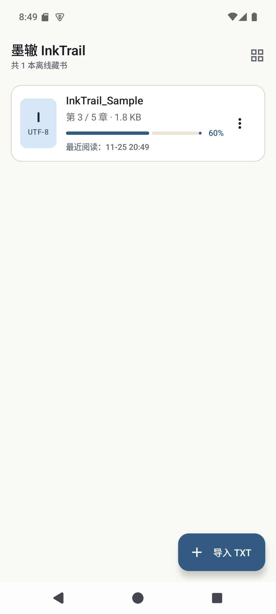
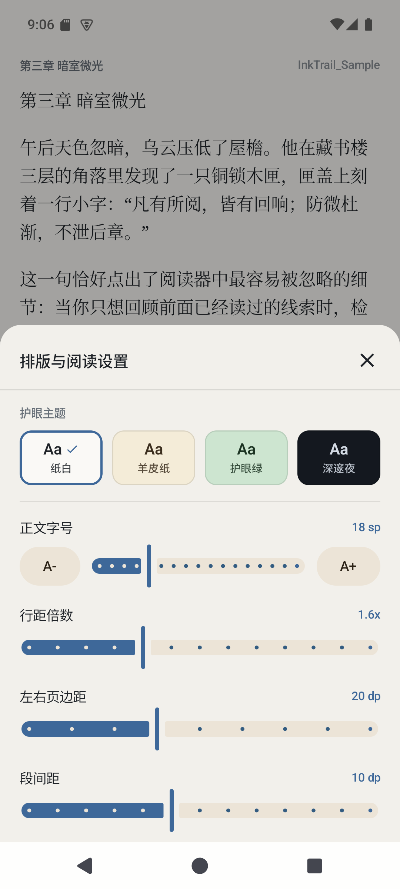
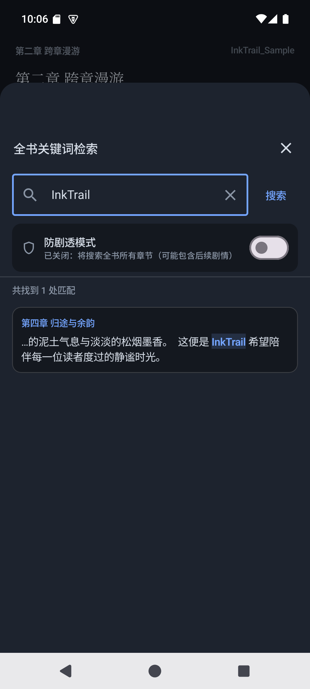
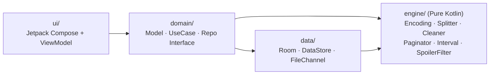

<div align="center">

# InkTrail（墨辙）

**专注本地 `.txt` 长篇阅读的原生 Android 离线阅读器**

大文件字节偏移流式加载 · 编码探测与排版清洗 · 重排锚点不漂移 · 防剧透进度感知检索


</div>

---

## 为什么做 InkTrail

阅读几十 MB 的本地纯文本小说时，常见阅读器经常遇到几个烦人的问题：一次性加载导致卡顿甚至 OOM、老旧 GBK 文本乱码、硬换行造成满屏断句、调整字号后阅读位置跳丢；重温前面剧情搜索关键词时，还很容易被后续章节剧透。

**InkTrail** 围绕这些高频痛点设计，纯离线运行、零广告，在原生性能与阅读质感之间取得平衡。

## 界面预览

<table>
  <tr>
    <td align="center" width="33%">
      
      <br /><sub>书架与本地导入</sub>
    </td>
    <td align="center" width="33%">
      
      <br /><sub>护眼主题与排版调节</sub>
    </td>
    <td align="center" width="33%">
      
      <br /><sub>划线批注与防剧透检索</sub>
    </td>
  </tr>
</table>

## 核心特性

### 1. 百兆大文件按章懒加载
* 导入本地 `.txt` 时通过 SAF 复制至应用私有目录，单遍流式扫描记录各章起止字节偏移（无标准目录或单章过长时，自动按 `24–32KB` 在换行符边界切分，避免截断多字节字符）。
* 阅读时仅通过 `FileChannel` 按需加载当前章及相邻缓存（最多保留 3 章），大文件秒开且内存占用恒定。

### 2. 编码探测与可控排版清洗
* 基于 `juniversalchardet` 结合 BOM 校验，自动识别 `UTF-8`、`GBK`、`GB18030`、`UTF-16` 等常见编码。
* 内置四项可独立开关的文本清洗规则：**合并多余空行**、**修复异常硬换行**、**中西文混排加空格**、**段首缩进规范**，随时可关闭以对照原文。

### 3. 字符偏移锚点与沉浸阅读体验
* 进度持久化锚定在 `(chapterIndex, charOffset)` 而非页码；调整字号、行距、页边距或切换清洗规则触发重排时，自动精准定位回当前阅读句。
* 内置 **纸白 / 羊皮纸 / 护眼绿 / 深邃夜** 4 套主题，并支持 **焦点行高亮** 模式（淡化上下文，突出当前行以防走神）。

### 4. 区间化划线批注与防剧透检索
* 长按正文滑动选段即可高亮、记笔记或局部擦除；底层区间管理器自动处理同色重叠/相接合并与异色覆盖拆分。
* 全书搜索与书签/笔记列表内置 **防剧透模式**：开启后严格按当前 `(chapterIndex, charOffset)` 截断结果，绝不泄露未读章节。

## 系统架构

项目采用 **MVVM + Clean Architecture** 分层设计。所有核心算法下沉至不依赖任何 Android SDK 的纯 Kotlin `engine/` 模块，可在本地 JVM 上直接运行单元测试。



```text
app/src/main/java/com/inktrail/reader/
├── engine/   # 纯 Kotlin 核心引擎（零 Android 依赖，完整单测覆盖）
├── data/     # Room 数据库、DataStore 偏好、SAF 拷贝与 FileChannel 读取
├── domain/   # 领域模型、Repository 接口与业务 UseCase
├── ui/       # 书架、沉浸式阅读页及目录/排版/搜索/批注组件
└── di/       # Hilt 依赖注入模块
```

## 技术栈与构建环境

| 维度 | 选型 / 版本 |
| :--- | :--- |
| **UI 与架构** | Jetpack Compose + Material 3（无 XML）、MVVM + Clean Architecture |
| **依赖注入与异步** | Hilt + KSP、Kotlin Coroutines + Flow |
| **本地存储** | Room（书籍、章节字节偏移、高亮与书签）、DataStore Preferences |
| **编码识别** | `com.github.albfernandez:juniversalchardet` |
| **单元测试** | JUnit 4、MockK、`kotlinx-coroutines-test` |
| **构建基线** | AGP `9.1.1`（内置 Kotlin `2.2.10`）、Gradle `9.3.1`、`minSdk 26` / `targetSdk 36` / `compileSdk 37` |

## 本地构建与测试

**环境要求**：JDK 11+、Android SDK Platform 37（建议使用最新版 Android Studio 打开）。

```bash
# 运行核心引擎与业务逻辑单元测试（纯 JVM 离线执行）
./gradlew testDebugUnitTest

# 构建 Debug 安装包
./gradlew assembleDebug
```

## 下载与版本

首个正式可用版本 **[v1.0.0](../../releases)** 已发布，包含完整的离线阅读、排版清洗、划线批注与防剧透检索功能，可在右侧 **Releases** 页面直接下载 APK 安装体验。
